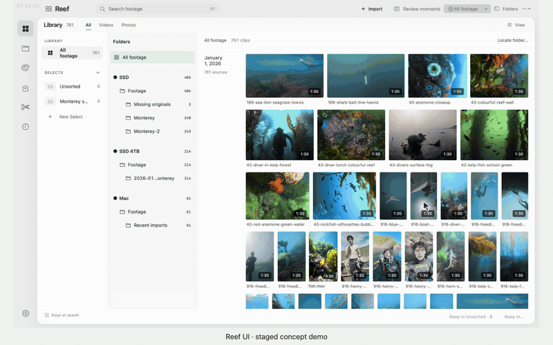
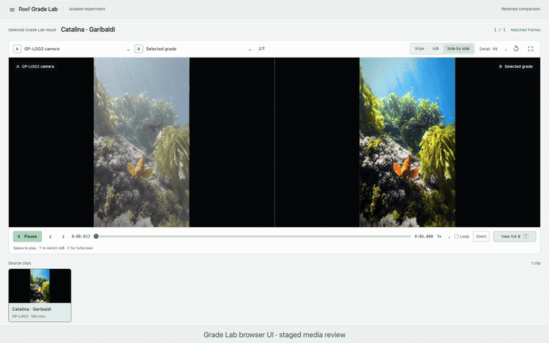
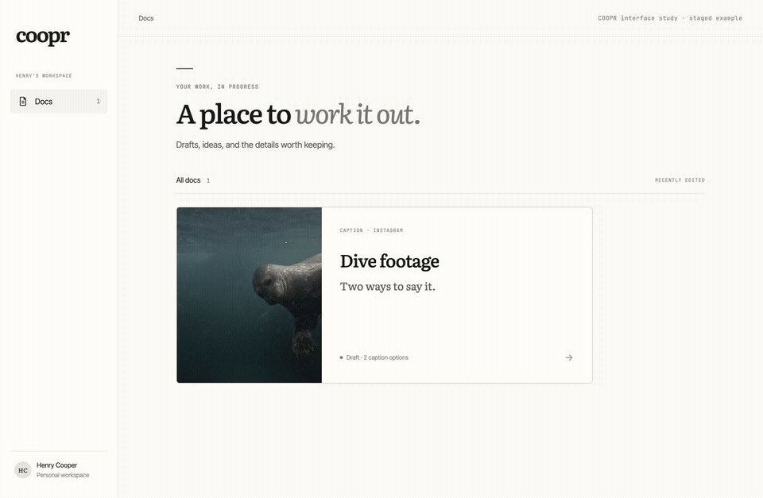

# Henry Cooper

**I build creative tools, from the interface down to the engine.**

Native Mac apps, video understanding, programmable editing, and tools that give creators control. Most of this work grew out of making my own underwater films.

## Reef · find the moment, shape the edit

<picture>
  <source media="(prefers-reduced-motion: reduce)" srcset="docs/assets/reef-workflow-poster.jpg">
  
</picture>

Staged concept walkthrough using Reef’s native interface and my Catalina footage. Prepared chat and proposed interactions; active development.

A native media workspace and Python engine for finding moments in footage, assembling editable reels, and shaping cuts, captions, audio, and playback through the interface or MCP tools.

**Swift / SwiftUI · Python · SQLite · FFmpeg · MCP** 
[Watch the full 90-second demo →](https://henryhcooperr.github.io/henryhcooperr/#reef) · [Explore the engineering →](projects/reef.md)

## Grade Lab · color from beneath the surface

<picture>
  <source media="(prefers-reduced-motion: reduce)" srcset="docs/assets/grade-lab-review-poster.jpg">
  
</picture>

Grade Lab’s browser review layout, restaged with my Catalina footage. Original GP-Log2 camera image at left; selected grade at right. Matched frames and synchronized playback; this demonstration does not run a new grade.

A specialized underwater grading toolchain: shot analysis, editable color treatments, motion review, and tools for revising supported grades in DaVinci Resolve.

**Python · NumPy · DaVinci Resolve / Fusion · DCTL · MCP** 
[Watch the before / after →](https://henryhcooperr.github.io/henryhcooperr/#grade-lab) · [Inside Grade Lab →](projects/grade-lab.md)

## COOPR / Content Brain · a workspace for the next idea

<picture>
  <source media="(prefers-reduced-motion: reduce)" srcset="docs/assets/coopr-caption-capture-document.jpg">
  
</picture>

COOPR interface study · staged example. A rebuilt preview using COOPR’s design language and sample content.

An experimental creator workspace combining video review, clip comparison, documents, writing-style feedback, and tools for turning ideas into hooks, scripts, and filming plans.

**React / TypeScript · Python · PostgreSQL · MCP** 
[Watch the interface study →](https://henryhcooperr.github.io/henryhcooperr/#coopr) · [Project notes →](projects/content-brain.md) · [Interface prototype source](https://github.com/henryhcooperr/coopr-prototype)

---

**CS (Machine Learning) + Applied Mathematics** · University of San Diego · Graduating in December.

Looking for **full-time software engineering roles**. Based in San Diego; remote preferred, open to San Francisco. [Connect on LinkedIn →](https://www.linkedin.com/in/henryhcooper/)

Reef and Grade Lab are in active development; COOPR is experimental. The full product repositories remain private. These pages share selected workflows and engineering notes. Also public: [my PyTorch model experiments](https://github.com/henryhcooperr/FaceRecognition-MultiArchitecture-Pipeline).
