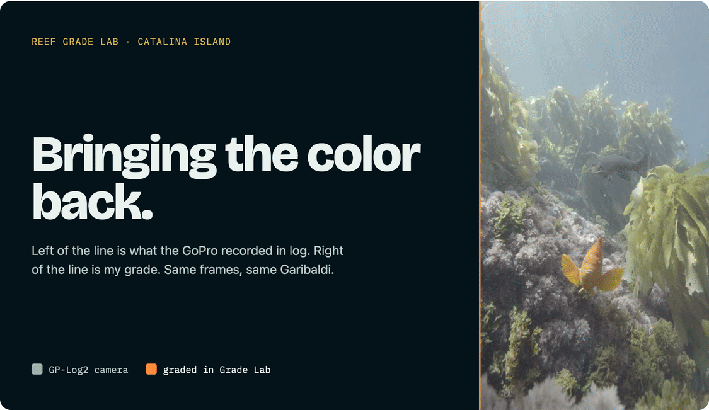
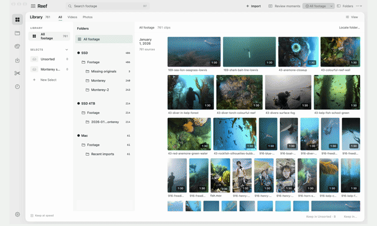
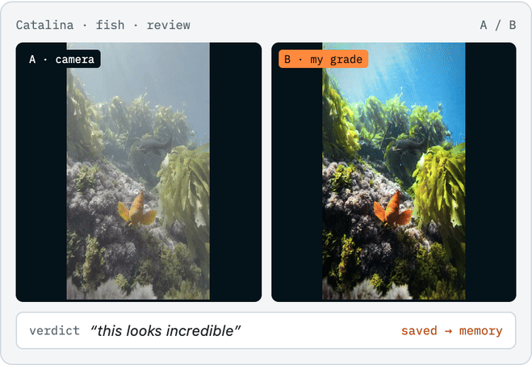
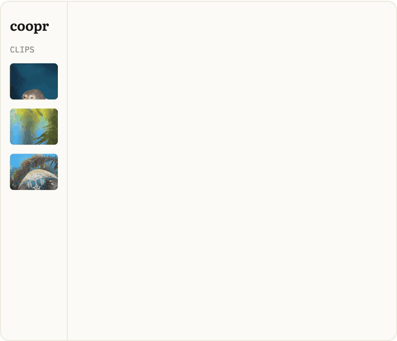
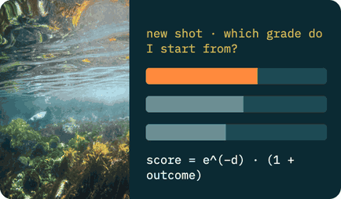
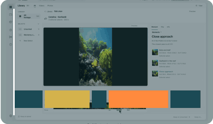
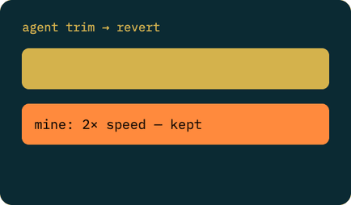
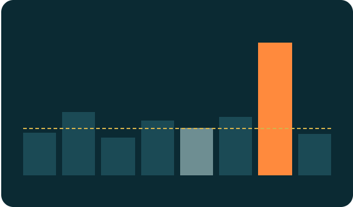
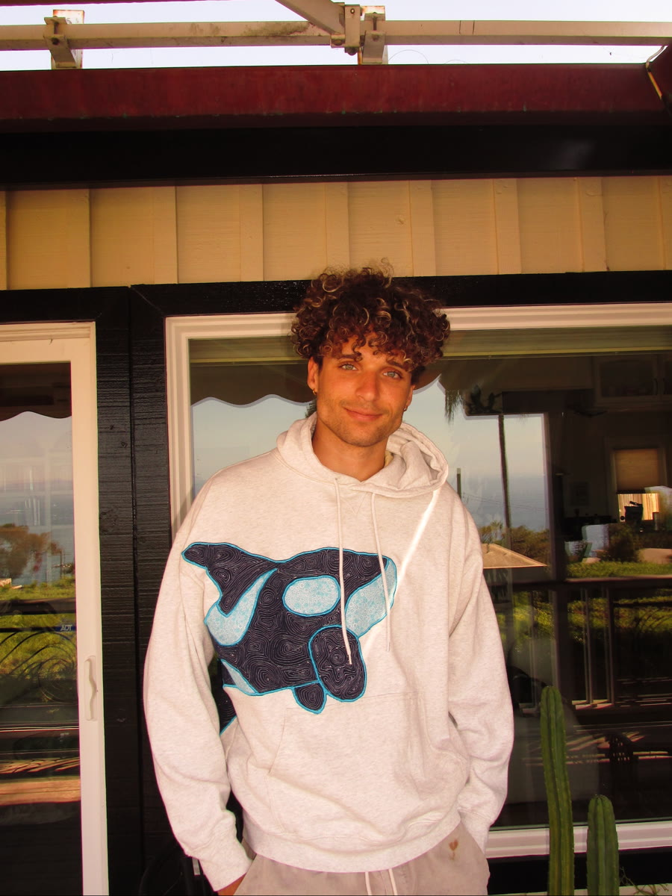

# Henry Cooper

**I build creative tools, from the interface down to the engine.**

Most of them start as a problem in my own life. I film dives in California kelp, so I built a native Mac editor that finds the moments, a color lab that learns how I like water to look, and agents that can actually work inside them. I like agent interfaces, and I like pushing what AI can do in a real tool.

**[See it in Grade Lab](https://github.com/henryhcooperr/grade-lab)** · [LinkedIn](https://www.linkedin.com/in/henryhcooper/) · San Diego · open to full-time SWE roles · remote or SF

## What I'm building

<table>
<tr>
<td width="50%" valign="top">

**Reef** — the native Mac editor I cut my dives in. It finds the moments in hours of footage, and an agent edits the same timeline I do. 
Swift · SwiftUI · Python engine · SQLite · MCP

</td>
<td width="50%" valign="top">

**Reef Grade Lab** — an agent grades my dive footage inside DaVinci Resolve through an MCP server I built, on real nodes I can keep editing, and starts each new shot from a grade I loved. 
Python · NumPy · DaVinci Resolve · DCTL · MCP

</td>
</tr>
<tr>
<td width="50%" valign="top">

**Social Lab** — lets an agent pull references from what it already knows about the clip, then checks whether each post really outperformed for its creator. 
Python · robust statistics · bootstrap · MCP

</td>
<td width="50%" valign="top">

**COOPR** — a creator workspace where the conversation, the clips and the document are the same thing. Pick a direction, and it lands in an editable draft. 
React · TypeScript · Python · PostgreSQL

</td>
</tr>
</table>

## Inside the engines

<table>
<tr>
<td width="33%" valign="top">

**Camera signal → underwater color** 
Log decode, linear light, luminance-preserving color, LUT.

</td>
<td width="33%" valign="top">

**Learning my eye** 
My feedback changes which past grade a new shot starts from.

</td>
<td width="33%" valign="top">

**Finding the moment** 
Subject, sharpness and motion signals become IN, PEAK and OUT.

</td>
</tr>
<tr>
<td width="33%" valign="top">

**Restoring color through water** 
Depth-aware inversion, and the pink surface it taught me to fix.

</td>
<td width="33%" valign="top">

**Sharing a timeline with an agent** 
Undo the agent's trim, keep my speed change, catch conflicts.

</td>
<td width="33%" valign="top">

**Which post actually outperformed?** 
Leave-one-out medians, robust scores, bootstrap uncertainty.

</td>
</tr>
</table>

## Why the repos are private

I ship to these every day, and they aren't ready to open yet. The contribution graph below is real; almost all of it lands in private repos.

Each product has a public **showcase repo** with demos, architecture and how it works. Small algorithms ship as runnable code in [reef-algorithm-studies](https://github.com/henryhcooperr/reef-algorithm-studies). Also public: [the COOPR interface prototype](https://github.com/henryhcooperr/coopr-prototype) and [my PyTorch model experiments](https://github.com/henryhcooperr/FaceRecognition-MultiArchitecture-Pipeline).

---

**CS (Machine Learning) + Applied Mathematics** · University of San Diego · graduating in December
